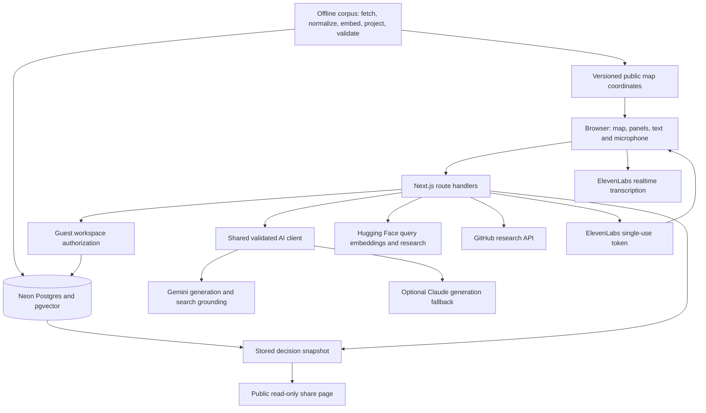

# Architecture and trust boundaries

Current design at `02fd1b8`; [specs/tech-stack.md](../../specs/tech-stack.md) is authoritative. The V3 document's
separate services, eve, Faiss and supervisor system were superseded; they are not part of this implementation.

## One application, two kinds of data

The Next.js application serves both the React interface and server route handlers. `components/` contains panels
and the map; `lib/` contains domain logic and provider adapters; `app/api/` exposes operations. Drizzle schemas
under `db/schema/` describe Neon tables. Vercel is the current hosting target; Vultr is an optional deployment.

The offline Python pipeline under `corpus/` imports source-backed project records, deduplicates, computes
embeddings and coordinates, validates a release, then publishes matching database/map data. Runtime requests
search the published corpus rather than crawling Devpost during the demo. Growing data requires an approved
source/publication decision; a larger number alone does not prove better relevance.

User ideas, immutable versions, evidence, votes and shares are application state. They are not new corpus records.
An accepted revision creates a new version; a suggestion is not permission to overwrite the user's choice.
Database/vector search provides semantic relevance. Display coordinates provide navigation only. The new flat
map initially uses the existing x/y projection; true 2D corpus layout and published classifications are separate
features, not implied by the renderer being merged.

## Boundaries that matter

- **Browser versus server:** database and provider secrets stay on the server. The browser receives only the
  short-lived speech token needed for transcription, never the ElevenLabs API key.
- **One guest versus another:** route handlers authorize the guest workspace before reading or writing its
  private state. Public shares expose stored read-only snapshots, not membership or a workspace session.
- **One vote versus both votes:** the server withholds the teammate's vote until both vote. Hiding a field in
  the component would not be sufficient; the canonical demo checks the API response.
- **Suggestion versus evidence:** generation is schema-validated. Claims distinguish supported, inferred and
  unverified information. A citation or score must not imply verification of a proposed product's implementation.
- **Current choice versus shared result:** sharing uses the chosen stored snapshot. Changing the workspace later
  must not silently change what the recipient sees.
- **Local versus production:** fixture tests, local live calls, deployed calls and human trials establish different
  facts. Green CI does not establish working provider billing or deployment environment variables.

These are intended and tested contracts, not a blanket security certification. The token/session hardening in
#221 is still pending at this audit; other known bugs are listed in the [release runbook](README.md).

## Source map for technical questions

| Question | Code / specification |
|---|---|
| How is a generation provider selected and retried? | `lib/ai/generate.ts`; `GEMINI_API_KEY_SPARE` follows primary Gemini; `AI_PROVIDER` selects preference |
| How are search-grounded claims obtained? | `lib/ai/grounded.ts`; grounding metadata is retained and checked |
| How do query embeddings find projects? | `lib/search/`; Neon pgvector; `corpus/embed/` for the offline counterpart |
| How do guests, invites and votes work? | `specs/features/guest-workspace/`, `specs/features/team-vote-api/` and their owned routes/schema |
| What survives a reload or share? | `specs/features/workspace-restore-api/`, `specs/features/decision-snapshot-api/`, `specs/features/share-qr-api/` |
| How are missing tables detected? | `scripts/db-sync.mjs`; additive preview first, coordinated application separately |
| What exactly was tested? | `changes/<slug>.md`, canonical feature Validation and GitHub CI for the exact SHA |

The practical tradeoff is one deployable app and pgvector instead of separate agent/numerical services. It reduces
operational coordination for the hackathon; provider latency, quota and schema rollout still need explicit handling.
